<!-- @section: cover -->
<!-- _class: undergraduate cover -->

# u08 ｜ 综合实践项目

**三天、六个模块：把一份未知细菌的读段，做成一份写明口径的基因含量清单。**

<div class="meta">

- 24 学时（3 天 × 8 h）｜ 占总成绩 90%（另 10% 为 L0）
- 数据 `/data/lab/ngs/reads.fa`（PacBio，约 4 Mb）
- 流程、命令、参数以《学生实验操作手册》为准
- 教材第 11 章 ＋ 第 8、9 章

</div>

---

<!-- _class: undergraduate divider -->

<div class="num">01</div>

# 学习目标

三天后，你能自己走完这条链

---

<!-- @section: objectives -->
## 三天后你应当能够（一）：M1–M3

- 用 Jellyfish 与 GenomeScope 勘测，比较三档 k
- 并行跑 Canu 与 Flye，按证据链选一套
- 用 Prokka 与 antiSMASH 做结构与功能注释
- 判断注释统计是否合理，而不是照抄数字

<div class="ref">教材 §11.2、§8.4.9、§9.4.5 ｜ 讲义 ①</div>

---

## 三天后你应当能够（二）：M4–M6

- 解释 ANI 95% 的来源与灰区边界
- 用 Mash 缩范围、FastANI 定种，选参考集
- 建单拷贝基因树，读出支持值的含义
- 算核心与附属规模，同时报 n、m、k

<div class="ref">教材 §11.2、§11.4.4、§11.6 ｜ 讲义 ①</div>

---

<!-- _class: undergraduate divider -->

<div class="num">02</div>

# 前置检查

六个 L0 模块，加同层七个单元

---

<!-- @section: prerequisites -->
## 前置检查（一）：L0 的前四个模块

| L0 模块 | 用在哪 | 缺了会怎样 |
|---|---|---|
| `l0_01_linux` | 建目录、`qsub`、看日志 | 作业交不上去 |
| `l0_02_r` | GenomeScope 图、ggtree 出图 | 图画不出来 |
| `l0_03_conda` | 四个环境创建与切换 | 第一天全在装环境 |
| `l0_04_formats` | FASTA／FASTQ／GFF | Roary 输入准备错 |

<div class="ref">教材 §11.3 ｜ 讲义 ② 2.1</div>

---

## 前置检查（二）：后两个模块与同层前置

| L0 模块 | 用在哪 | 缺了会怎样 |
|---|---|---|
| `l0_05_qc` | 判断 `reads.fa` 能不能用 | 分不清数据差与参数错 |
| `l0_06_stats` | 读 BUSCO 比例、ANI、支持值 | 报告变成流水账 |

- `l0_06_stats` 是本科唯一没有对应单元的模块，参考线 ≥ 80%
- 同层前置：u01–u07 全部，缺一环就卡在当天

<div class="ref">教材 §11.3 ｜ 讲义 ② 2.1 ｜ 自测 L0-6</div>

---

## 就绪清单（一）：账号、环境、目录

- 能 ssh 登录集群，知道自己的家目录与配额
- 四个 conda 环境建成，`command -v` 有输出
- 最小 `qsub` 作业跑过，`.o` 日志里有内容
- 七个工作子目录建好（六模块 ＋ `fq/`），`reads.fa` 可见

<div class="ref">讲义 ② 2.2 ｜ 手册 §3.4</div>

---

## 就绪清单（二）：数据与文档

- `grep -c "^>"` 数出读段条数，记进报告
- L0-6 统计自测已提交，正确率 ≥ 80%
- 通读手册目录，知道 §4.1–§4.6 对应哪个模块
- 下载报告模板，边做边填

<div class="ref">讲义 ② 2.2 ｜ 手册 §4.1–§4.6、§5.1</div>

---

<!-- _class: undergraduate divider -->

<div class="num">03</div>

# 科学问题

三个问题，一条不可颠倒的链

---

<!-- @section: background -->
## 场景：一份 16S 卡在灰区的分离株

<div class="cols">
<div>

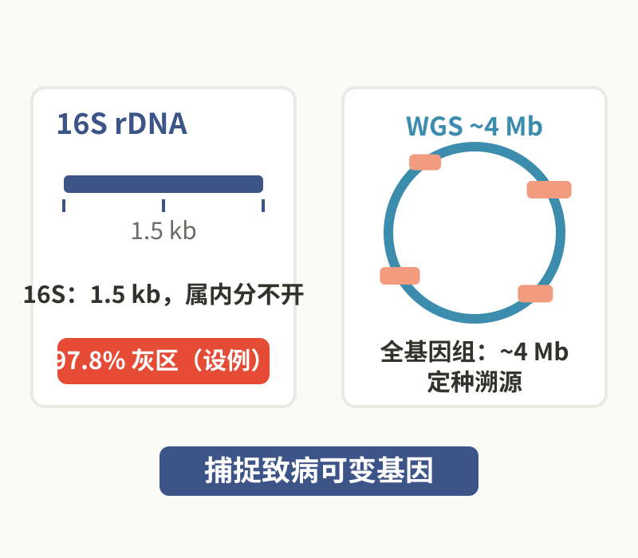

</div>
<div>

### 已经知道
植保站送来枯萎病灶分离物，生化提示黄单胞菌属

### 还不知道
灰区：可能是同种另一株，也可能是新种

- 三天内要答案：一条证据链，不是一句“像谁”

</div>
</div>

<div class="ref">教材 §11.1 ｜ 讲义 ③ 3.1 ｜ 图内 97.8% 是设例</div>

---

## 三个问题，各自的答案落在哪个模块

| 问题 | 为什么是真问题 | 落在哪个模块 |
|---|---|---|
| 它是谁？ | 16S 只有 1.5 kb，属内分不开 | M1 → M2 → M4 |
| 从哪来、和谁最近？ | 溯源要的是在谱系里的位置 | M5 |
| 能干什么、危险在哪？ | 同种不同株，基因集并不相同 | M3、M6 |

<div class="ref">教材 §11.1、§18.4.1、§18.4.5 ｜ 讲义 ③ 3.1</div>

---

<!-- _class: undergraduate statement -->

六个模块的顺序由数据依赖决定，不是教学安排的顺序。

没有组装，定种与注释就没有坐标；定种错了，树与泛基因组都白做。

---

<!-- _class: undergraduate figure -->

## 六模块证据链与选型关口

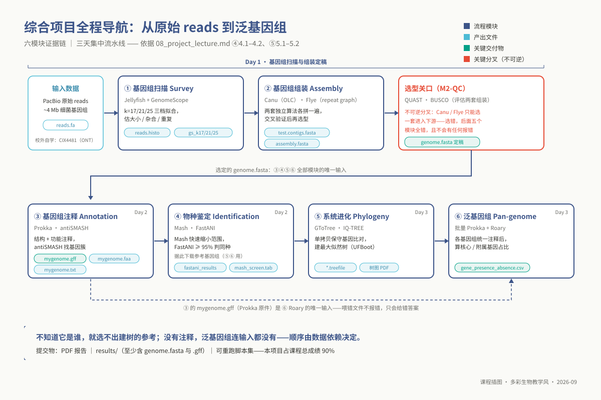

顺序由数据依赖决定，M2-QC 不可逆

<div class="ref">教材 §11.1 ｜ 图内 M1–M6 是讲义编号</div>

---

<!-- _class: undergraduate figure -->

## 为什么值得较真：一场军备竞赛

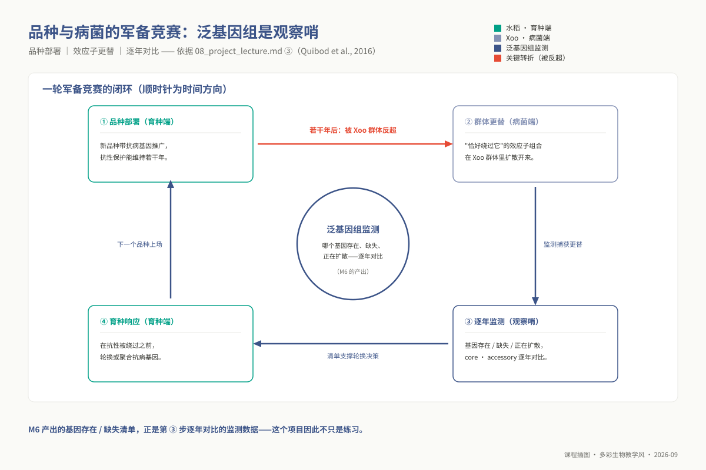

基因存在／缺失清单，是育种监测的观察哨

<div class="ref">教材 §11.1 图 11-1 ｜ 讲义 ③ 3.2</div>

---

<!-- _class: undergraduate divider -->

<div class="num">04</div>

# 核心原理

六个模块的接口，比六条命令重要

---

<!-- @section: principles -->
## 输入输出契约（一）：M1–M3

| 模块 | 消费 | 产出／下游 |
|---|---|---|
| M1 勘测 | `reads.fa` | 大小、杂合、重复 → M2 的 `genomeSize` |
| M2 组装 | 读段 ＋ 大小先验 | 两套 FASTA → M3–M6 全部 |
| M2-QC | 两套组装 | QUAST ＋ BUSCO → 人选型 |
| M3 注释 | 选定的 `genome.fasta` | `.gff` → M6；BGC → 报告 |

- BGC＝次级代谢生物合成基因簇，只进报告
- `.faa` 只用来数每株蛋白数

<div class="ref">教材 §11.4.2、§8.4.9 ｜ 讲义 ④ 4.2</div>

---

## 输入输出契约（二）：M4–M6 与出图

<div class="cols">
<div>

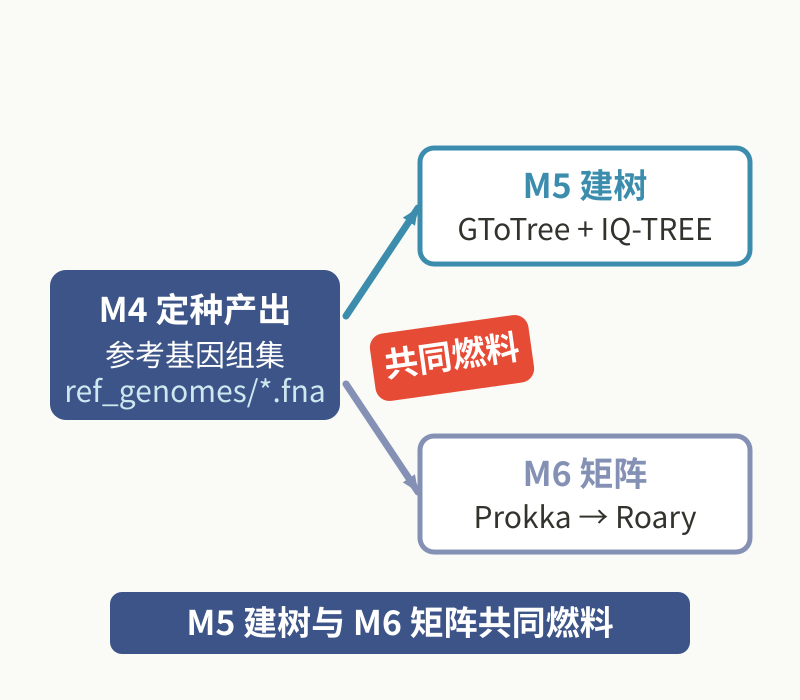

</div>
<div>

- M4 出 ANI ＋ 参考清单，喂 M5、M6
- M5 出 `.treefile`；M6 出存在／缺失矩阵
- 出图：树图、饼图、矩阵图
- 喂错文件：可能报错，也可能跑完而矩阵无效

</div>
</div>

<div class="ref">教材 §11.4.2、§11.4.3 ｜ 讲义 ④ 4.2</div>

---

<!-- _class: undergraduate statement -->

M2 选错，后面五个模块全错——而且不会报错。

断链是静默的：每个工具都正常退出，图也照常画出来。

---

## 依赖一：M4 的副产物才是燃料

- 定种真正值钱的，是参考基因组清单
- 手册 §4.4.3 的 GCF 编号只是语法示例
- 照抄示例编号，技术准确性直接扣分
- 参考太少或太远，树就没有信息量

<div class="ref">教材 §11.4.2、§11.6 ｜ 讲义 ④ 4.3</div>

---

## 依赖二、三：跨环境与不可逆

<div class="cols">
<div>

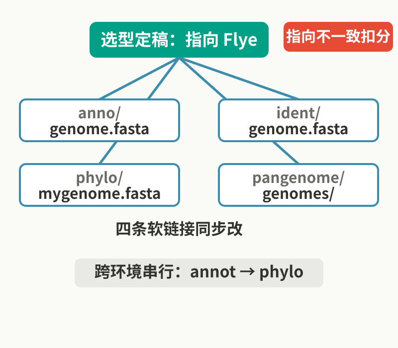

</div>
<div>

- 批量 Prokka 在 `ngs_ug_annot`
- Roary 在 `ngs_ug_phylo`
- 一个脚本只能激活一个环境
- 嘴上选 Flye、链接指 Canu，批改会核对

</div>
</div>

<div class="ref">教材 §11.4.2 ｜ 讲义 ④ 4.3 ｜ 手册 §4.6.3</div>

---

<!-- _class: undergraduate figure -->

## 存在／缺失矩阵怎么读

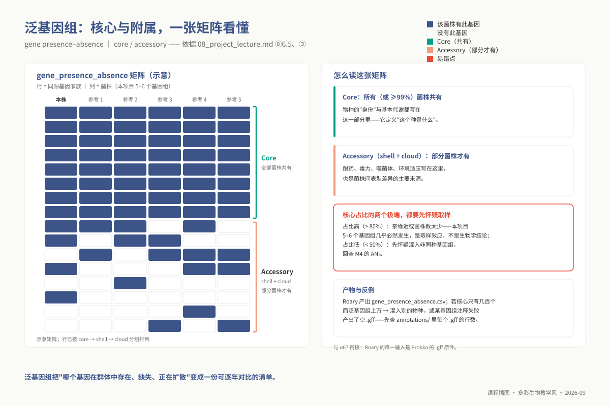

图内 6 列与 >80%／<50% 都是设例，不是判据；按 n 与选株读

<div class="ref">教材 §11.4.4 图 11-2（图面校准见正文）</div>

---

## 核心与附属是观测分类，不是功能证明

<div class="cols">
<div>

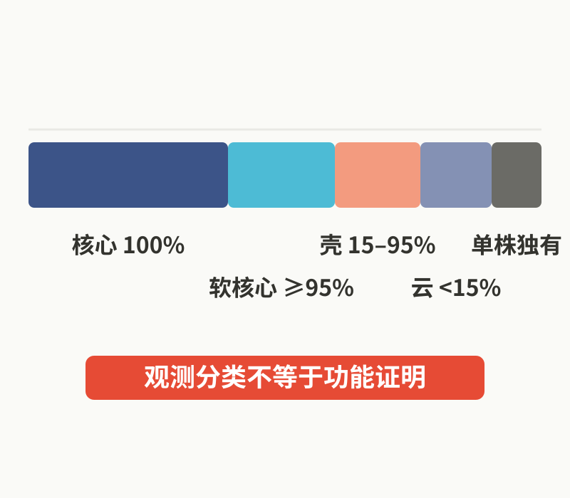

</div>
<div>

- 核心：`m = n`，但不等于必需
- 云 ≠ 噬菌体、转座子或假基因
- n 小时软核心可能一株都没有
- 要连到功能，得另做富集或实验

</div>
</div>

<div class="ref">教材 §11.4.4 ｜ 术语见教材 §11.3</div>

---

## n = 12 时，95%／99%／100% 是同一件事

<div class="cols">
<div>

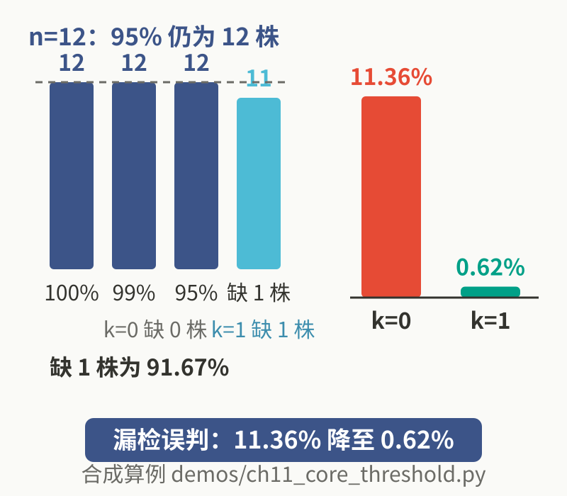

</div>
<div>

- 阈值退化是整数约束，不是软件缺陷
- 报告一律写“允许缺失 k 株（≈ x%）”
- 放宽一株，也是在对抗注释漏检

</div>
</div>

<div class="ref">教材 §11.4.4、§11.5.2 ｜ 演示 ch11_core_threshold.py</div>

---

<!-- _class: undergraduate quiz -->

## 课堂提问

核心占比 80%，能说这个物种的核心特别大吗？

---

## 两条曲线：一条往上，一条往下

<div class="cols">
<div>

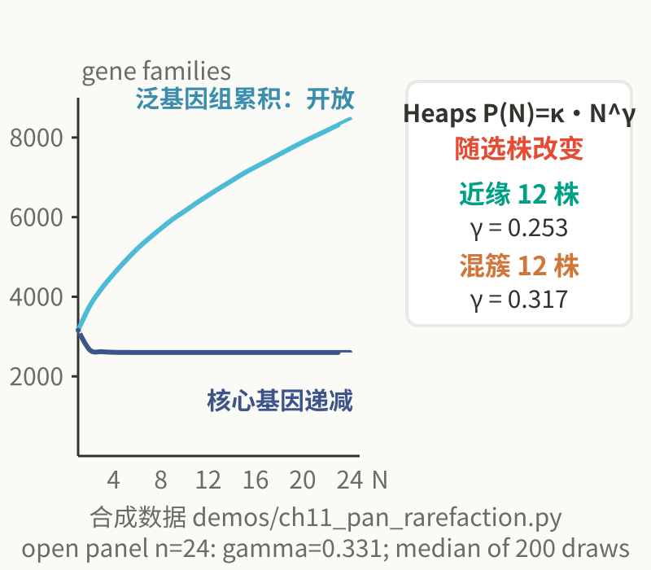

</div>
<div>

- 末端还在上升：只能说“开放趋势”
- 曲线描述这批样本，不是物种常数
- 报告写清 N、选株与拟合窗口

</div>
</div>

<div class="ref">教材 §11.3（符号）、§11.4.5、§11.5.3 ｜ 演示 ch11_pan_rarefaction.py</div>

---

<!-- _class: undergraduate figure -->

## 泛基因组二十年：从并集到图参考

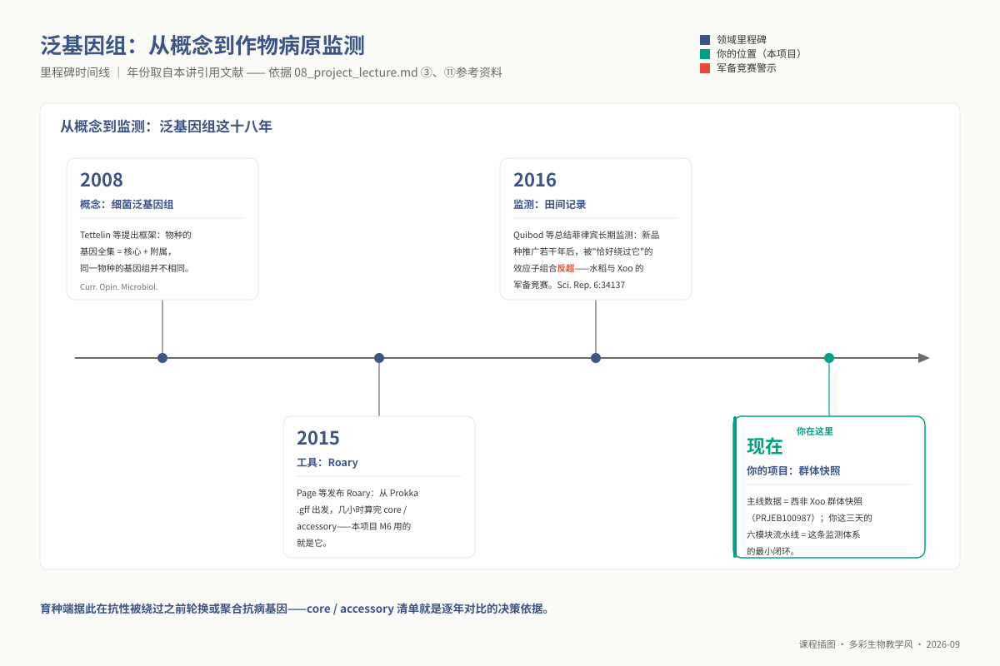

读图校准：2005 才是概念提出年，2008 是框架综述

<div class="ref">教材 §11.4.7 ｜ 讲义 ③ 3.2（图内 2008 标“概念”）</div>

---

<!-- _class: undergraduate divider -->

<div class="num">05</div>

# 操作流程

集群规矩，然后是六个模块

---

<!-- @section: procedure -->
## 集群规矩：先读这段

> 登录节点只编辑、提交、看结果；计算一律 `qsub`，或先 `qrsh` 申请节点。

- `qstat -u ${USER}`：qw 排队、r 运行、Eqw 出错
- 日志 `<作业名>.o<JOB_ID>` 在提交目录，先 `cat`
- 登录节点跑 Canu 会吃满内存，只剩一行 `Killed`
- 单步 > 10 min、内存 > 2 GB、线程 > 1 就 `qsub`

<div class="ref">教材 §8.5.3 ｜ 讲义 ⑤ 5.0</div>

---

## 作业头：六行指令，加两行激活

<div class="cols">
<div>

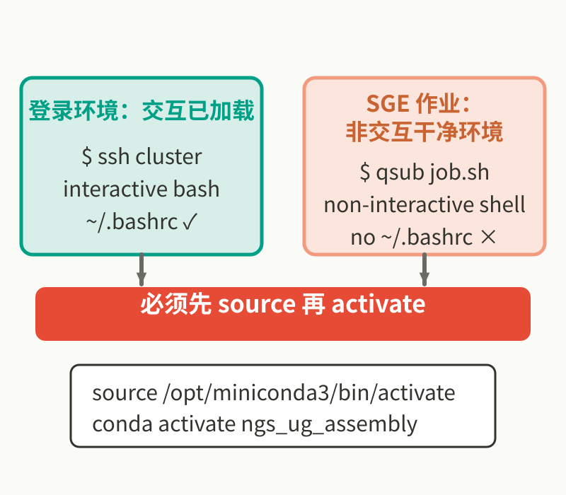

</div>
<div>

```bash
#!/bin/bash
#$ -S /bin/bash
#$ -N u08_m2_assem
#$ -cwd
#$ -pe smp 4
#$ -l h_vmem=8G
source /opt/miniconda3/bin/activate
conda activate ngs_ug_assembly
```

- `<(…)` 得配 `-S /bin/bash`

</div>
</div>

<div class="ref">讲义 ⑤ 5.0 ｜ 手册 §3.2、§4.2.3（Canu 作业头要 -l h_vmem=8G）</div>

---

## 环境映射：手册写一个大环境，我们分四个

| 步骤 | 环境 | 关键工具 |
|---|---|---|
| 勘测与组装 | `ngs_ug_assembly` | jellyfish、canu、flye、quast、busco |
| 注释与批量重注释 | `ngs_ug_annot` | prokka、antismash |
| 定种、建树、Roary | `ngs_ug_phylo` | mash、fastani、gtotree、iqtree、roary |
| 树图与泛基因组出图 | `ngs_ug_phylo` | ggtree 只在 phylo，不在 base |

- GenomeScope 出图用 assembly 里的 `Rscript`

<div class="ref">讲义 ⑤ 5.3 ｜ 02_plot_tree_and_pangenome.R 头部</div>

---

## 导航（一）：M1 与 M2

| 模块 | 手册 | 环境 | 墙钟（4 核） |
|---|---|---|---|
| M1 勘测 | §4.1.3 | assembly | 20–40 min |
| M1 拟合 | §4.1.3 | assembly | 2–5 min |
| M2 Canu | §4.2.3 | assembly | 1.5–4 h（最长） |
| M2 Flye | §4.2.3 | assembly | 25–60 min |

- 校外自学轨道：`bash 06_data/undergraduate/download_ug.sh --run`

<div class="ref">讲义 ⑤ 5.1、5.3 ｜ 手册 §4.1.3、§4.2.3</div>

---

## 导航（二）：M2 质量评估与 M3

| 模块 | 手册 | 环境 | 墙钟（4 核） |
|---|---|---|---|
| M2 QUAST ＋ BUSCO | §4.2.3 | assembly | 25–55 min |
| M3 Prokka | §4.3.3 | annot | 8–20 min |
| M3 antiSMASH | §4.3.3 | annot | 30–90 min |

- QUAST 与 BUSCO 并行提交，别串行等

<div class="ref">讲义 ⑤ 5.1 ｜ 手册 §4.2.3、§4.3.3</div>

---

## 导航（三）：M4、M5、M6

| 模块 | 手册 | 环境 | 墙钟（4 核） |
|---|---|---|---|
| M4 Mash | §4.4.3 | phylo | 约 30 min（含 6 GB 库） |
| M4 FastANI | §4.4.3 | phylo | 5–15 min |
| M5 GToTree ＋ IQ-TREE | §4.5.3 | phylo | 30–70 min |
| M6 批量 Prokka → Roary | §4.6.3 | annot → phylo | 40–80 ＋ 20–50 min |

- M5 另含 Mashtree（手册 §4.5.3 步骤 2）：与 GToTree 比拓扑

<div class="ref">讲义 ⑤ 5.1 ｜ 手册 §4.4.3、§4.5.3、§4.6.3</div>

---

## 三天日程：每天必须有产出

| 日程 | 上午 | 下午 | 当天产出 |
|---|---|---|---|
| Day 1 | M1 ＋ 同时投 Canu、Flye | M2 收尾 ＋ QUAST/BUSCO | 对比表、`genome.fasta` |
| Day 2 | M3 Prokka ＋ antiSMASH | M4 ＋ 下载参考基因组 | ANI 表、参考清单 |
| Day 3 | M5 建树 ＋ 树图 | M6 注释 → Roary → 出图 | 树图、核心／附属、草稿 |

<div class="ref">讲义 ⑤ 5.2</div>

---

<!-- _class: undergraduate statement -->

Day 1 第一件事：Canu 与 Flye 同时提交。

等待的数小时用来做 M1、读手册；不要串行等。

---

## M1：先数 k-mer

```bash
jellyfish count -C -m 21 -s 1000000000 -t 4 \
  -o reads.k21.jf <(zcat ../fq/*.fq.gz)
jellyfish histo -t 4 reads.k21.jf > reads.k21.histo
Rscript genomescope.R reads.k21.histo 21 100 gs_k21 1000
```

- 三档 k：17／21／25，各出一份 `.histo`
- 校内 PacBio 是纯 FASTA：把 `<(zcat …)` 换成 `../fq/reads.fa`

<div class="ref">手册 §4.1.3 ｜ 教材 §8.4.3</div>

---

## M2：两套组装都跑

<div class="cols">
<div>

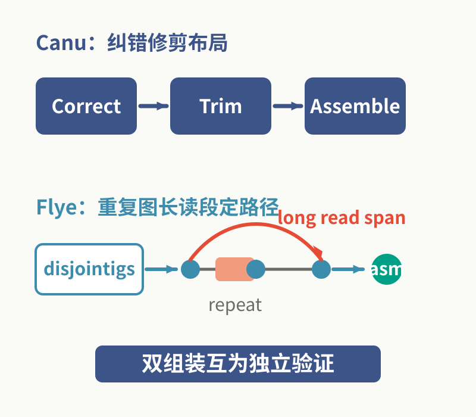

</div>
<div>

```bash
canu -p test -d test-pacbio \
  genomeSize=4m \
  -pacbio /data/lab/ngs/reads.fa
flye --pacbio-raw \
  /data/lab/ngs/reads.fa \
  --out-dir out_pacbio \
  --genome-size 4m --threads 4
```

- 两套输出目录分开，路径才对得上
- 改先验大小后，清空输出目录再重跑

</div>
</div>

<div class="ref">手册 §4.2.3 ｜ 教材 §8.5.3、§8.4.5</div>

---

## M2-QC：连续性、完整性、结构证据

```bash
cd /d3/scratch/${USER}/ngs/assem
quast.py canu/test-pacbio/test.contigs.fasta \
        flye/out_pacbio/assembly.fasta -o quast_results -t 4
busco -i canu/test-pacbio/test.contigs.fasta -o busco_canu \
      -m genome -l bacteria_odb10 -c 4 --offline \
      --download_path /path/to/lineages
```

- 两套同库自比，报告写库名与 `n`
- 无 `-r`：报告只能写“未检查错接”
- 计算节点无外网：登录节点预下载谱系库

<div class="ref">手册 §4.2.3 ｜ 教材 §8.4.8、§8.5.2、§8.5.4（--offline 为课程侧手动补）</div>

---

## M3：注释与次级代谢

<div class="cols">
<div>

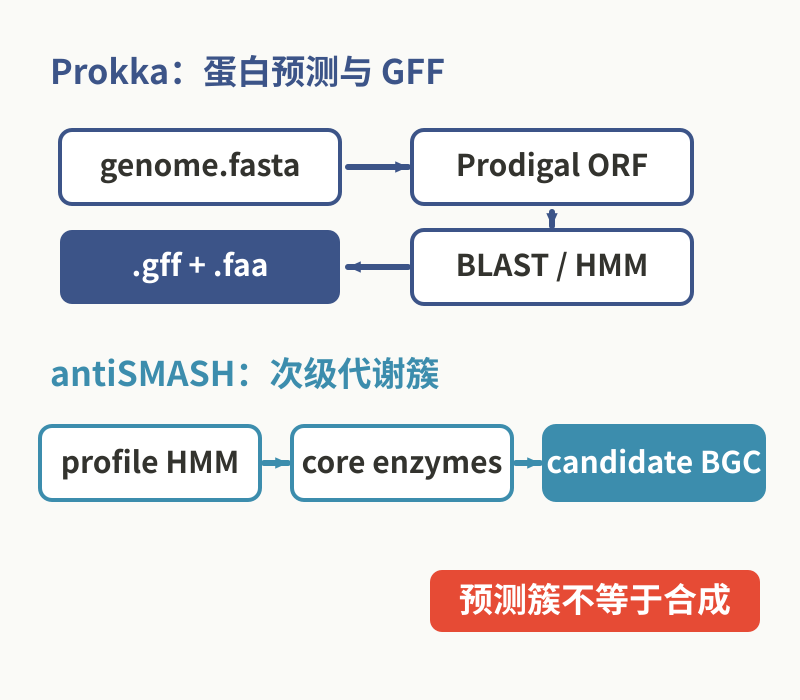

</div>
<div>

```bash
prokka --outdir prokka_out \
  --prefix mygenome \
  --kingdom Bacteria --cpus 4 \
  genome.fasta
antismash --output-dir \
  antismash_out \
  --genefinding-tool prodigal \
  --taxon bacteria genome.fasta
```

- `genome.fasta` 走软链接；antiSMASH 库先下载

</div>
</div>

<div class="ref">手册 §4.3.3 ｜ 教材 §9.4.3、§9.5.5</div>

---

## M4：先 Mash 缩范围，再 FastANI 定种

<div class="cols">
<div>

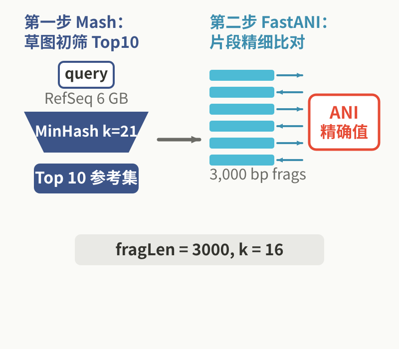

</div>
<div>

```bash
mash screen -w -p 4 \
  refseq.genomes.k21s1000.msh \
  genome.fasta > mash_screen.tab
ls ref_genomes/*.fna \
  > ref_list.txt
fastANI -q genome.fasta \
  --rl ref_list.txt \
  -o fastani_results.txt -t 4
```

- 排序取前 10 再下参考，别照抄示例

</div>
</div>

<div class="ref">手册 §4.4.3 ｜ FastANI README（fragLen 3000、k = 16）</div>

---

## M5：两种树、一套支持值

<div class="cols">
<div>

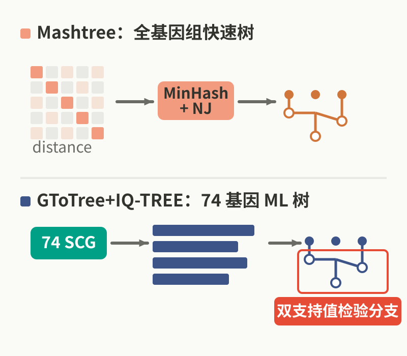

</div>
<div>

```bash
mashtree --numcpus 4 \
  genomes/* > mashtree.dnd
GToTree -f genome_files.txt \
  -H Bacteria -j 4 -o gtotree_out
iqtree -s \
  gtotree_out/Aligned_SCGs.faa \
  -m LG+F+I+G4 \
  -bb 1000 -alrt 1000 -nt 4
```

- `-bb`/`-alrt` 是次数，不是阈值；树图用 `ngs_ug_phylo` 的 ggtree

</div>
</div>

<div class="ref">手册 §4.5.3 ｜ 教材 §11.4.3</div>

---

## M6：两个作业，两个环境

```bash
# 作业一（ngs_ug_annot）：批量重注释
for genome in genomes/*.fasta genomes/*.fna; do
  base=$(basename "${genome}" | sed 's/\.[^.]*$//')
  prokka --outdir annotations/$base --prefix $base \
         --kingdom Bacteria --cpus 4 "${genome}"
done
# 作业二（ngs_ug_phylo）：直接吃各株的 .gff
roary -f roary_out -e -n -v -p 4 annotations/*/*.gff
```

- 输入必须是含 `##FASTA` 的 Prokka 原件
- Roary 默认核心阈值 99%

<div class="ref">手册 §4.6.3 ｜ 教材 §11.4.2</div>

---

## 课程环境没覆盖的四个工具

| 工具 | 出现在 | 处理办法 |
|---|---|---|
| `genomescope.R` | §4.1.3 | 契约已豁免；`wget` 后 `Rscript` |
| `emapper.py` | §4.3.3 | 时间紧可跳过，报告写明 |
| `nw_display` | §4.5.3 | 跳过，用 ggtree 出图 |
| `roary_plots.py` | §4.6.3 | 失败就用 R 出图，报告写明 |

- 跳过不等于没做：写清哪一步、为什么、用什么替代

<div class="ref">讲义 ⑤ 5.3 ｜ 手册 §4.3.3、§4.5.3、§4.6.3</div>

---

<!-- _class: undergraduate divider -->

<div class="num">06</div>

# 结果解读

每个数字后面，都要写清口径

---

<!-- @section: interpretation -->
<!-- _class: undergraduate warn -->
## 结果不对时长什么样

| 现象 | 说明什么 | 先做什么 |
|---|---|---|
| 频谱无主峰，单调滑落 | 深度不足或原始长读长 | 换低错误率短读长 |
| 总长偏小、N50 反而升 | 重复塌缩或错接 | 回贴看深度与接缝 |
| 核心几百、泛基因组上万 | 混入异种或注释失败 | 查蛋白数与 `.gff` 行数 |
| 某株特异基因高一个量级 | 注释口径不一致 | 同流程同参数重注释 |

共同点：全部正常跑完、正常出图，没有任何报错。

<div class="ref">教材 §8.5.3、§8.5.2、§11.5.1 ｜ 失效条件</div>

---

## 选型按证据链走，不从 BUSCO 开始

<div class="cols">
<div>

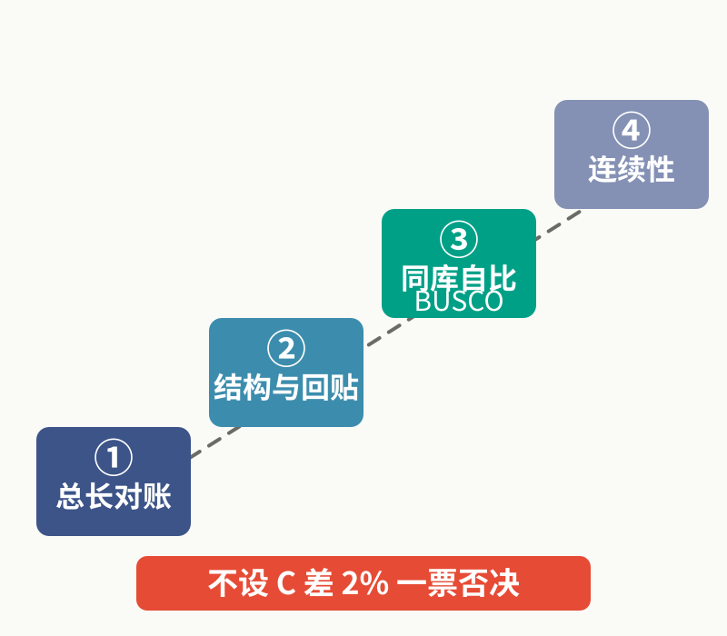

</div>
<div>

1. 总长与勘测估计对账
2. 结构证据：回贴深度、错接
3. 同库 BUSCO：报库名与 n
4. 最后才看 contig 数与 N50

</div>
</div>

<div class="ref">教材 §8.4.9 ｜ 讲义 ⑥ 6.2</div>

---

<!-- _class: undergraduate statement -->

本章不给 D 设百分比红线，也不设“C 差 2% 一票否决”。

n = 124 时，一个基因就是 0.81 个百分点。

<div class="ref">教材 §8.4.9、§8.4.8 ｜ 演示 ch08_n50_vs_completeness.py</div>

---

## 设例：C 都是 98.4%，怎么选

<div class="cols">
<div>

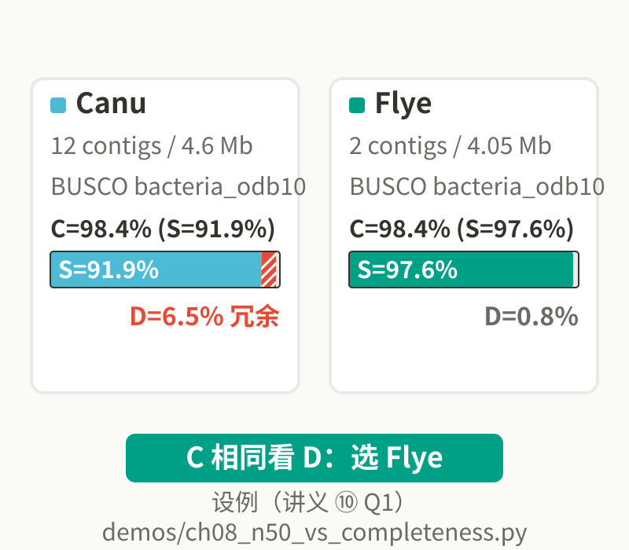

</div>
<div>

- 设例（讲义 ⑩ Q1），不是本批数据的实测
- C 相同不等于一样：先看 D 的来源
- D 高三类原因：两套序列、混入近缘菌、真实复制
- 选型前按第二步对账，确认没有丢段

</div>
</div>

<div class="ref">教材 §8.4.8、§8.4.9 ｜ 讲义 ⑩ Q1（设例）</div>

---

## 注释统计：先报口径，再报数字

- CDS 4,000–4,600／株（预期，未实测）
- 密度 851–979 个/Mb（4,000/4.7 起算）
- 编码比例、假定蛋白、rRNA 无通用区间
- 偏离只触发排查；rRNA 为 0 先查塌缩

<div class="ref">教材 §9.4.5 ｜ 06_data/undergraduate/README.md §四（预期）</div>

---

## 预测到基因簇，不等于该化合物被合成

- 核心酶只说明具备合成潜力
- region 与 protocluster 边界都是预测
- 报 0 个簇不是“分析失败”

<div class="ref">教材 §9.4.5、§9.5.4</div>

---

## ANI 落在 95–96%：三条证据再下结论

- 比对片段占比：高 ANI 低占比＝局部同源
- Mash 排序：候选与参考集是否自洽
- 树上的位置：是否落在同种簇内
- ANI 分得了种，分不了致病变种

<div class="ref">教材 §11.6 ｜ 边界来源 Jain 2018（见教材 §11.8）</div>

---

<!-- _class: undergraduate figure -->

## ANI 阈值与灰区

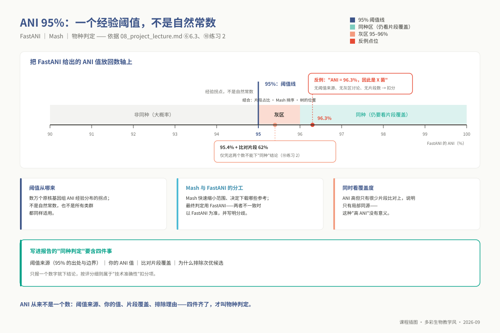

灰区 95–96%：三条证据一起看

<div class="ref">教材 §11.6 ｜ 讲义 ⑥ 6.3 ｜ 图内编号与评分字样为讲义口径</div>

---

## 支持值是重抽样稳定性，不是分支为真的概率

- 支持值＝重抽样稳定性，不是分支为真的概率
- `UFBoot`（超快自展）≥ 95；`SH-aLRT` ≥ 80
- 节点按 `UFBoot／SH-aLRT` 标，两个都达标才算强支持
- 常用线出自 IQ-TREE 文档，不是自然常数

<div class="ref">IQ-TREE 文档 iqtree.org ｜ UFBoot2（Hoang 2018）｜ 教材 §11.4.3</div>

---

<!-- _class: undergraduate figure -->

## 怎么读一棵进化树

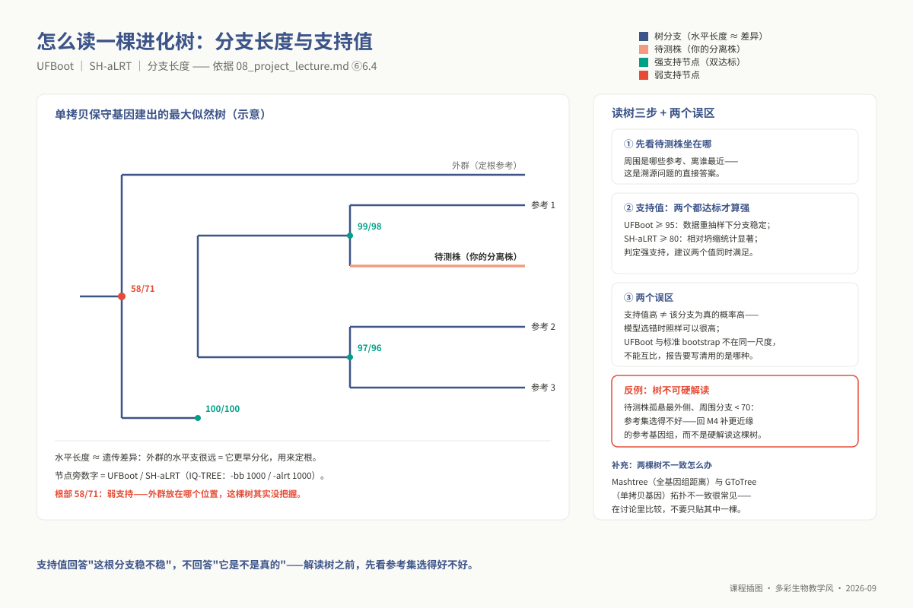

外群定根；支持值只说稳定性，不说概率

<div class="ref">教材 §11.4.3、§11.4.6 ｜ 讲义 ⑥ 6.4</div>

---

## 核心占比：先报 n、m、k，再谈生物学

`n` 总株数 ｜ `m` 该家族出现的株数 ｜ `k` 允许缺失的株数

- 小样本占比偏高常见，但不是必然
- 同一固定面板取子集，严格核心不降
- 占比偏低：先查混入异种，再查注释失败
- 不设 50% 这条线

<div class="ref">教材 §11.3（符号）、§11.4.4、§11.5.2 ｜ 讲义 ⑥ 6.5（经验说法）</div>

---

<!-- _class: undergraduate statement -->

单株漏检 1% 且各株独立、n = 12 时，11.36% 的真核心基因会跌出 100% 核心。

放宽到允许缺 1 株，误判概率降到 0.62%。

<div class="ref">教材 §11.4.4、§11.5.2 ｜ 演示 ch11_core_threshold.py --miss-rates 0.005 0.01 0.02 0.05</div>

---

<!-- _class: undergraduate divider -->

<div class="num">07</div>

# 常见错误

四条高频错误，加一条手册小坑

---

<!-- @section: troubleshooting -->
<!-- _class: undergraduate warn -->
## 错误一：在登录节点跑大任务

- 指纹：只有一行 `Killed`，或 fork 报错
- 登录节点内存吃满会被内核杀掉
- 一律 `qsub`；交互先 `qrsh -pe smp 4`
- 大纲 §6.3 把这条列为规范性底线

<div class="ref">教材 §8.5.3 ｜ 讲义 ⑨ E1 ｜ 大纲 §6.3</div>

---

<!-- _class: undergraduate warn -->
## 错误二：`command not found` 怎么查

1. 脚本没写 `source …/activate` 与 `conda activate`
2. 激活错环境：Prokka 在 annot，Roary 在 phylo
3. 环境没建成功
4. 登录 shell 里激活过，对作业无效

<div class="ref">教材 §11.4.2 ｜ 讲义 ⑨ E2 ｜ 讲义 ⑤ 5.3</div>

---

<!-- _class: undergraduate warn -->
## 错误三：Roary 跑完，核心基因是 0

<div class="cols">
<div>

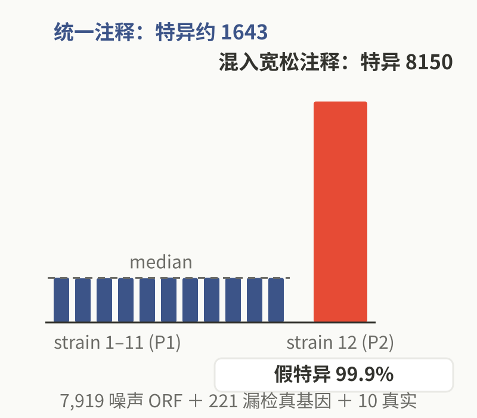

</div>
<div>

- 喂了 NCBI `.fna`，不是 Prokka `.gff`
- 喂了切掉 `##FASTA` 的显示副本
- 某株 Prokka 失败，`.gff` 只有表头
- 先查每株蛋白数与 `.gff` 行数

</div>
</div>

<div class="ref">教材 §11.5.1、§9.5.2 ｜ 讲义 ⑨ E8 ｜ 图内为 demos/ch11_annotation_bias.py 合成算例</div>

---

<!-- _class: undergraduate warn -->
## 错误四：k-mer 频谱没有主峰

<div class="cols">
<div>

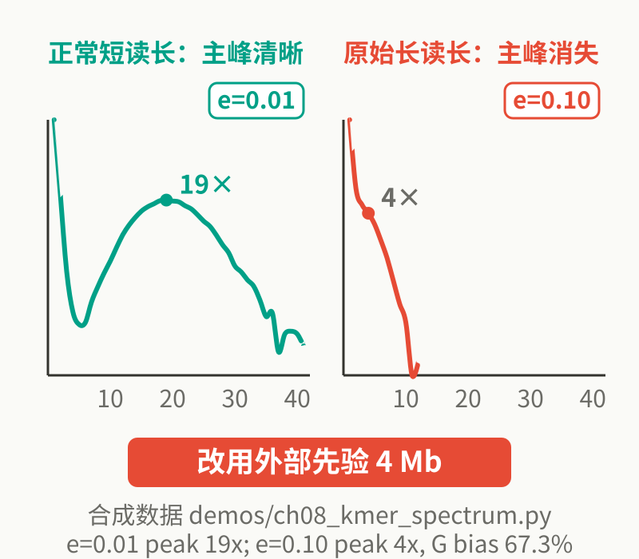

</div>
<div>

- 拿原始 ONT／PacBio CLR 直接勘测
- e = 0.10 时，89.1% 的 21-mer 含错
- 主峰缺失：勘测数字不可用，改用外部先验
- 判断标准是频谱有没有主峰，不是平台标签

</div>
</div>

<div class="ref">教材 §8.5.3 ｜ 讲义 ⑨ E5 ｜ 图内为 demos/ch08_kmer_spectrum.py 合成数据</div>

---

<!-- _class: undergraduate warn -->
## 错误五：手册的小坑与资源限制

- `ftp://` 换 `https://`，并加 `-c` 断点续传
- 大写 `/D3/SCRATCH` 改小写 `/d3/scratch`
- 配额 50 GB：先清 `correction/` 等中间目录
- 计算节点无外网：BUSCO 在登录节点预下载

<div class="ref">教材 §8.5.4 ｜ 讲义 ⑨ E3–E7 ｜ 手册锚定，不改手册</div>

---

<!-- _class: undergraduate divider -->

<div class="num">08</div>

# 交付

评分口径、提交物、思考练习

---

<!-- @section: wrapup -->
## 评分：五个维度对应哪些产出

| 维度 | 分值 | 由什么兑现 |
|---|---|---|
| 内容完整性 | 30 | 六模块都有步骤、结果、讨论 |
| 技术准确性 | 30 | 参数对、结论与证据一致、脚本能重跑 |
| 分析深度 | 20 | 选型有数字、异常有解释 |
| 报告规范性 | 10 | 按模板、图表编号、GB/T 7714-2015 |

- 创新性 10：手册之外的分析，如回贴验证、CheckM
- 目标 7 是重心：脚本能重跑，结论指到证据

<div class="ref">手册 §5.3 ｜ undergrad_project.md</div>

---

## 提交物：一个 PDF、一个 zip、一套脚本

- `学号_姓名_NGS综合项目报告.pdf`
- zip 至少含 `genome.fasta` 与 `.gff`
- 脚本集不得写死他人的绝对路径
- 每张图有编号，图题在下、表题在上

<div class="ref">手册 §5.1–§5.2 ｜ undergrad_project.md</div>

---

## 思考练习（一）：讲义 ⑩ Q1–Q4

- Q1 C 都是 98.4%、S／D 不同，为何选 Flye
- Q2 ANI 95.4%、片段占 62%，能下同种结论吗
- Q3 某株 `.gff` 只有表头，错误怎样传到 Roary
- Q4 支持值 98% 不等于拓扑为真的概率 98%

<div class="ref">教材 §11.7、§8.4.8 ｜ 讲义 ⑩（Q1 设例）</div>

---

## 思考练习（二）：Q5 与开放题 Q6

- Q5 菌株数从 5–8 增到 500，两条曲线怎么变
- Q6 选一个自己的研究对象，写 300–500 字
- Q6 写进报告 §8「讨论与心得」
- 六题都不给答案，先自己写再对教材

<div class="ref">教材 §11.7 ｜ 讲义 ⑩ Q5（设例）、实践报告模板</div>

---

## 实验指导与收尾

- `11_lab_guides/undergraduate/08_project_lab.md`
- 上机时手边打开：检查点、出错信号都在里面
- 文献只给指针（讲义 ⑪），本 deck 不重复列
- 每天收工前，把当天产出填进报告

**这一步选定的 FASTA，是后面全部模块的输入。**

<div class="ref">教材 §11.6 ｜ 讲义 ⑩、⑪ ｜ 手册 §5.1</div>
